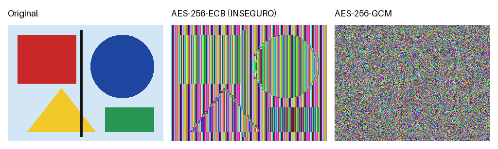

# Kit criptográfico en Python

Colección de módulos de criptografía para aprender cómo se aplican la **integridad** (hashes), la **confidencialidad** (AES-GCM) y la **autenticidad** (firma digital RSA), y cómo se rompen los cifrados antiguos. Usa la librería [`cryptography`](https://cryptography.io/); no inventa algoritmos modernos propios.

> **Proyecto educativo.** No está auditado y **no debe usarse para proteger datos reales.**

Autora: Micaela Acuña.

## Funcionalidades

| Qué | Dónde |
|---|---|
| **Hashing e integridad:** SHA-256 de archivos leídos por bloques y verificación en tiempo constante | `src/kit_cripto/hashing.py` |
| **Cifrados clásicos y criptoanálisis:** César y Vigenère; fuerza bruta contra César; análisis de frecuencias (índice de coincidencia y chi-cuadrado) contra Vigenère | `src/kit_cripto/clasicos.py` |
| **Cifrado de archivos con AES-256-GCM** y clave derivada de una contraseña con scrypt | `src/kit_cripto/simetrico.py` |
| **Firma digital RSA-PSS:** generar el par de claves, firmar un archivo y verificar la firma | `src/kit_cripto/asimetrico.py` |
| **Demo visual de por qué ECB es inseguro**, comparado con GCM | `scripts/demo_ecb.py` |
| **Informe de análisis de TLS:** una conexión HTTPS real observada con OpenSSL y Wireshark | `docs/analisis-tls.md` |

Cuenta con 335 tests automáticos y 99 % de cobertura (ver [Tests](#tests)).

## Instalación y requisitos

- **Python:** probado con 3.13 y 3.14 en Windows 11. El código usa sintaxis de tipos que requiere Python 3.10 o superior.
- **Dependencias** (con versión exacta, en `requirements.txt`): `cryptography` 50.0.2, `pillow` 13.0.0 (solo la usa la demo de ECB) y `pytest` 8.4.2.

En PowerShell:

```powershell
git clone https://github.com/mica-acuna/kit-criptografico-python.git
cd kit-criptografico-python
python -m venv .venv
.\.venv\Scripts\Activate.ps1
python -m pip install -r requirements.txt
```

En Linux o macOS los pasos equivalen a `source .venv/bin/activate` para activar el entorno (no se probó en esos sistemas).

El kit no se instala como paquete: para importarlo desde cualquier carpeta, indicá dónde está `src/`. Conviene probar los ejemplos en una carpeta de trabajo **fuera del repositorio**, para no mezclar archivos de prueba:

```powershell
$env:PYTHONPATH = "$PWD\src"                       # desde la raíz del repo
mkdir "$env:TEMP\kit-demo"; cd "$env:TEMP\kit-demo"   # carpeta de trabajo
```

Después, pegá los ejemplos de abajo en `python` o guardalos en un archivo `.py`.

## Ejemplos de uso

### Hashes e integridad (SHA-256)

`kit_cripto.hashing` calcula el hash SHA-256 de un archivo y verifica si fue modificado. Lee en bloques de 64 KB, así que no carga el archivo entero en memoria. La comparación usa `hmac.compare_digest`, que tarda lo mismo sin importar dónde difieran los hashes.

```python
from pathlib import Path
from kit_cripto.hashing import sha256_archivo, verificar

Path("documento.txt").write_bytes(b"hola")
huella = sha256_archivo("documento.txt")
print(huella)                              # b221d9dbb083a7f33428d7c2a3c3198ae925614d70210e28716ccaa7cd4ddb79
print(verificar("documento.txt", huella))  # True

Path("documento.txt").write_bytes(b"hola!")
print(verificar("documento.txt", huella))  # False: el archivo cambió
```

### Cifrados clásicos y su criptoanálisis

> **Advertencia:** son cifrados didácticos y **no sirven para proteger información real**. El módulo incluye los ataques que los rompen.

Trabajan con el alfabeto A-Z, respetan mayúsculas y minúsculas y dejan intactos espacios, números, signos y letras con acento.

```python
from kit_cripto.clasicos import (
    cesar_cifrar, cesar_romper, vigenere_cifrar, vigenere_romper,
)

print(cesar_cifrar("Hola, mundo", 3))      # Krod, pxqgr

frase = "Los mensajes secretos de los romanos se rompen con facilidad si uno conoce el idioma."
print(cesar_romper(cesar_cifrar(frase, 5)))   # (5, 'Los mensajes secretos de los romanos se rompen ...')

print(vigenere_cifrar("Ataque al amanecer", "LIMON"))   # Lbmehp ix ozlvqqrc

texto = (
    "La criptografía es la ciencia que estudia cómo proteger la información para que solo "
    "las personas autorizadas puedan leerla. Desde la antigüedad, los pueblos buscaron "
    "maneras de ocultar sus mensajes: los espartanos enrollaban tiras de cuero alrededor "
    "de un bastón y los romanos desplazaban las letras del alfabeto para que un mensajero "
    "no pudiera revelar el contenido de una carta si era capturado. Con el tiempo, los "
    "cifrados se volvieron más complejos, pero también aparecieron los analistas, que "
    "aprendieron a romperlos observando cuántas veces se repite cada letra en un texto."
)
clave, descifrado = vigenere_romper(vigenere_cifrar(texto, "CIFRA"))
print(clave, descifrado == texto)          # CIFRA True
```

- `cesar_fuerza_bruta` devuelve los 26 desplazamientos posibles; `cesar_romper` elige el más probable comparando con las frecuencias de las letras del español.
- `vigenere_romper` estima el largo de la clave con el índice de coincidencia y recupera cada letra con chi-cuadrado contra las frecuencias del español.

### Cifrado de archivos con AES-GCM

`kit_cripto.simetrico` cifra y descifra archivos con **AES-256-GCM**. La clave no sale directo de la contraseña: se deriva con **scrypt** (N=2^17, r=8, p=1) y una sal aleatoria de 16 bytes. Cada cifrado usa además un nonce aleatorio de 12 bytes. Si la contraseña es incorrecta o el archivo fue alterado, se lanza `ErrorDescifrado` y no queda ningún archivo de salida.

```python
from getpass import getpass
from pathlib import Path
from kit_cripto.simetrico import cifrar_archivo, descifrar_archivo, ErrorDescifrado

Path("notas.txt").write_text("Mi diario secreto", encoding="utf-8")
contrasena = getpass("Contraseña: ")       # nunca la escribas en el código
cifrar_archivo("notas.txt", "notas.txt.kcripto", contrasena)

descifrar_archivo("notas.txt.kcripto", "notas_recuperadas.txt", contrasena)
print(Path("notas_recuperadas.txt").read_text(encoding="utf-8"))   # Mi diario secreto

try:
    descifrar_archivo("notas.txt.kcripto", "otra_salida.txt", "una contraseña equivocada")
except ErrorDescifrado as error:
    print(error)   # No se pudo descifrar: contraseña incorrecta o archivo alterado.
```

**Formato del archivo cifrado (versión 1):**

| Campo | Tamaño | Detalle |
|---|---|---|
| Marca | 7 bytes | `KCRIPTO` |
| Versión | 1 byte | `1` |
| Sal | 16 bytes | Aleatoria, nueva en cada cifrado |
| Nonce | 12 bytes | Aleatorio, nuevo en cada cifrado |
| Texto cifrado + etiqueta | datos + 16 bytes | La etiqueta de GCM autentica todo |

Los primeros 36 bytes (marca, versión, sal y nonce) se usan como datos asociados (AAD): modificar cualquiera hace fallar el descifrado.

### Firma digital (RSA-PSS)

`kit_cripto.asimetrico` genera un par de claves RSA (3072 bits por defecto, exponente 65537), firma archivos con **RSA-PSS y SHA-256** y verifica firmas. La clave privada se guarda en PEM **cifrada con una contraseña**; la pública, en PEM. El archivo se hashea por bloques. La firma es un archivo binario aparte.

```python
from getpass import getpass
from pathlib import Path
from kit_cripto.asimetrico import (
    generar_par_claves, firmar_archivo, verificar_firma, guardar_firma, leer_firma,
)

Path("contrato.txt").write_text("El proveedor entrega 100 unidades.", encoding="utf-8")
Path("claves").mkdir(exist_ok=True)         # carpeta ignorada por git (ver .gitignore)
contrasena = getpass("Contraseña de la clave privada: ")   # nunca la escribas en el código

# 1. Generar el par de claves
generar_par_claves("claves/privada.pem", "claves/publica.pem", contrasena)

# 2. Firmar un documento y guardar la firma
firma = firmar_archivo("contrato.txt", "claves/privada.pem", contrasena)
guardar_firma(firma, "contrato.sig")

# 3. Verificar con la clave pública (esto lo puede hacer cualquiera)
print(verificar_firma("contrato.txt", leer_firma("contrato.sig"), "claves/publica.pem"))   # True

# 4. Si alguien cambia el documento, la verificación falla
Path("contrato.txt").write_text("El proveedor entrega 900 unidades.", encoding="utf-8")
print(verificar_firma("contrato.txt", leer_firma("contrato.sig"), "claves/publica.pem"))   # False
```

- Una firma inválida **no lanza excepción**: devuelve `False`. Un archivo inexistente, una clave mal formada o una contraseña incorrecta sí dan un error claro (`FileNotFoundError` o `ErrorClave`).
- `generar_par_claves` **no sobrescribe** claves existentes salvo que pases `sobrescribir=True`, y rechaza claves de menos de 2048 bits.

### Demo: por qué ECB es inseguro

Se cifra una imagen con AES-256 en modo **ECB** y con **GCM**. En ECB se siguen viendo las formas del dibujo; en GCM, solo ruido. Explicación en [docs/ecb_vs_gcm](docs/ecb_vs_gcm/README.md).



Para regenerar las imágenes en otra carpeta (por defecto reemplaza las de `docs/ecb_vs_gcm/`), desde la raíz del repo:

```powershell
python scripts/demo_ecb.py --salida "$env:TEMP\ecb-demo"
```

> **ECB nunca se usa en sistemas reales.** Está solo en `scripts/demo_ecb.py`, fuera del paquete `kit_cripto`, con una función llamada `cifrar_ecb_inseguro`.

### Informe: análisis de una conexión TLS real

Se observó una conexión HTTPS a `example.org` con OpenSSL y `tshark` (el motor de Wireshark): TLS 1.3 con AES-256-GCM, intercambio de claves híbrido post-cuántico, certificado ECDSA y cadena de confianza de 4 niveles. Se compara TLS 1.2 con 1.3 y se muestra dónde aparecen en una conexión real los conceptos del kit (SHA-256, AES-GCM, firma digital y cadena de confianza): **[docs/analisis-tls.md](docs/analisis-tls.md)**.

## Decisiones de seguridad

- **Librería probada, sin criptografía propia moderna:** AES-GCM, scrypt, RSA-PSS y SHA-256 vienen de `cryptography`. Las únicas implementaciones propias son los cifrados clásicos, que son históricos y están marcados como no seguros.
- **Clave derivada de la contraseña con scrypt** (N=2^17, r=8, p=1, los mínimos recomendados por OWASP), con sal aleatoria nueva en cada cifrado.
- **Nonce aleatorio de 12 bytes** en cada cifrado de AES-GCM, nunca reutilizado con la misma clave. El encabezado, la sal y el nonce se autentican como datos asociados (AAD).
- **Errores sin filtrar detalles:** una contraseña incorrecta y un archivo alterado dan el mismo mensaje. Nunca se imprime ni se registra una contraseña o una clave.
- **Sin archivos a medias:** el descifrado se escribe en un temporal y se renombra al final, y si falla no queda salida.
- **Comparaciones en tiempo constante** (`hmac.compare_digest`) al verificar hashes.
- **Firma RSA-PSS con SHA-256** (no PKCS#1 v1.5), claves de al menos 2048 bits (3072 por defecto) y clave privada guardada cifrada. En POSIX se crea con permisos `0o600`; no se sobrescribe sin pedirlo.
- **Las claves no se suben al repositorio:** el `.gitignore` excluye `*.pem`, `*.key`, `*.sig`, `claves/`, `.env` y las capturas de red (`*.pcap`, `*.pcapng`). El historial completo se revisó con [gitleaks](https://github.com/gitleaks/gitleaks). Los 2 hallazgos que marcó son falsos positivos (cadenas de texto de encabezados PEM en un test) y están documentados en `.gitleaksignore`.
- **ECB aislado:** el modo inseguro solo existe en la demo, fuera del paquete, con `inseguro` en el nombre de la función.

## Limitaciones conocidas

- **Proyecto didáctico, sin auditoría.** No usar para proteger información real.
- **AES-GCM en memoria:** `simetrico.py` lee, cifra y escribe el archivo entero, así que no es apto para archivos muy grandes. Un diseño para eso cifraría por bloques, cada uno con su propio nonce.
- **Python no permite borrar de forma segura** la contraseña ni la clave de la memoria.
- **`vigenere_romper` necesita texto suficiente:** funciona con unos 400 caracteres o más y claves cortas. Nunca prueba claves de más de 1/15 de las letras del texto, aunque `largo_max_clave` sea mayor; con textos cortos y claves largas puede fallar (en una prueba con 45 casos, acertó 39).
- **Las frecuencias de letras del español son aproximadas** y varían según el corpus; el ataque tolera esas diferencias.
- **Permisos de la clave privada:** el modo `0o600` solo se aplica en POSIX. En Windows hay que guardarla en una carpeta que solo pueda leer tu usuario y fuera de carpetas sincronizadas (por ejemplo OneDrive). El test de ese comportamiento no se pudo ejecutar en Windows.
- **El informe TLS usa la salida de `tshark`** y no incluye capturas de pantalla de la interfaz gráfica de Wireshark.
- **Probado solo en Windows 11** con Python 3.13 y 3.14.

## Tests

Con el entorno activado:

```powershell
python -m pip install -r requirements-dev.txt
pytest
```

**Resultado actual: 334 tests pasan y 1 se saltea, con 99 % de cobertura.** El que se saltea comprueba los permisos `0o600` de la clave privada, que solo se pueden verificar en Linux y macOS.

| Módulo | Tests | Cobertura |
|---|---|---|
| `hashing.py` | 30 | 100 % |
| `clasicos.py` | 109 | 100 % |
| `simetrico.py` | 78 | 100 % |
| `asimetrico.py` | 77 | 99 % |
| `demo_ecb.py` | 41 | 98 % |
| **Total** | **335** | **99 %** |

| Qué | Comando |
|---|---|
| Con cobertura (muestra las líneas sin cubrir) | `pytest --cov=kit_cripto --cov=demo_ecb --cov-report=term-missing` |
| Sin los tests lentos (scrypt y RSA con parámetros reales) | `pytest -m "not lento"` |
| Solo los lentos | `pytest -m lento` |
| Un solo módulo | `pytest tests/test_hashing.py` |
| Un solo test | `pytest tests/test_hashing.py::test_vectores_conocidos` |
| En orden fijo (sin mezclar) | `pytest -p no:randomly` |
| Repetir un orden aleatorio que falló | `pytest -p randomly --randomly-seed=NÚMERO` (el número se muestra al inicio de cada corrida) |

- Los tests **no escriben dentro del repositorio**: todo va a carpetas temporales (`tmp_path`), incluidas las claves RSA que generan.
- `pytest-randomly` mezcla el orden en cada corrida, para comprobar que los tests no dependen unos de otros.
- Casos borde y de error: archivos vacíos y de varios MB, contraseñas con emojis, archivos truncados o alterados byte por byte, firmas de largo incorrecto, claves mal formadas y fallos de escritura simulados. Los problemas que encontraron los tests están descriptos en los commits de corrección.

## Organización de carpetas del proyecto

```
kit-criptografico-python/
├── .gitignore
├── .gitleaksignore
├── README.md
├── pytest.ini
├── requirements.txt
├── requirements-dev.txt
├── scripts/
│   └── demo_ecb.py
├── src/
│   └── kit_cripto/
│       ├── __init__.py
│       ├── asimetrico.py
│       ├── clasicos.py
│       ├── hashing.py
│       └── simetrico.py
├── tests/
│   ├── test_asimetrico.py
│   ├── test_clasicos.py
│   ├── test_demo_ecb.py
│   ├── test_hashing.py
│   └── test_simetrico.py
└── docs/
    ├── analisis-tls.md
    └── ecb_vs_gcm/
```

| Ruta | Qué contiene |
|---|---|
| `.gitignore` | Archivos que git no debe versionar: claves privadas (`*.pem`, `*.key`), firmas de prueba (`*.sig`), la carpeta `claves/`, variables de entorno (`.env`), capturas de red (`*.pcap`, `*.pcapng`) y sus claves de sesión (`*keylog*`), cachés de Python, archivos de cobertura, el entorno virtual (`.venv/`) y `prueba.txt`. Evita subir secretos por accidente. |
| `.gitleaksignore` | Las 2 huellas de falsos positivos de gitleaks, con la explicación. |
| `README.md` | Este archivo. |
| `pytest.ini` | Configuración de pytest: rutas de `src/` y `scripts/`, carpeta de tests, `-ra` y el marcador `lento`. |
| `requirements.txt` | Dependencias con versión exacta. |
| `requirements-dev.txt` | Dependencias de desarrollo: incluye `requirements.txt` más `pytest-cov` y `pytest-randomly`. |
| `scripts/demo_ecb.py` | Demo visual de por qué ECB es inseguro, fuera del paquete a propósito. |
| `src/kit_cripto/` | Paquete con el código del kit: `hashing.py`, `clasicos.py`, `simetrico.py` y `asimetrico.py`. Está dentro de `src/` para separarlo de los tests y la documentación. |
| `tests/` | Un archivo de tests por módulo, más los de la demo. |
| `docs/analisis-tls.md` | Informe de observación de una conexión HTTPS real. |
| `docs/ecb_vs_gcm/` | Imágenes y explicación de la demo de ECB. |
