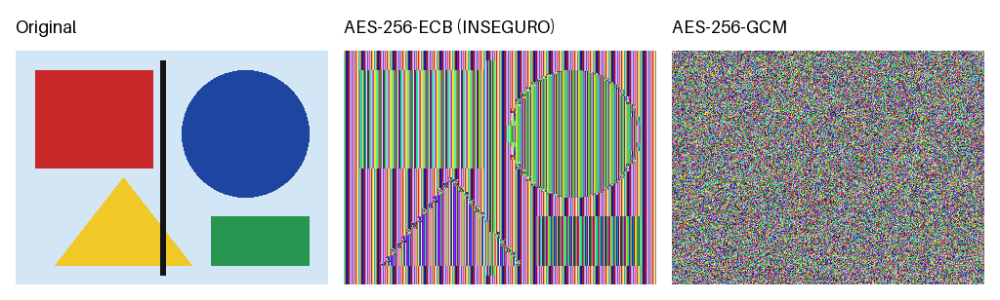

# Demo: por qué el modo ECB es inseguro

> **Aviso:** ECB **nunca** se usa en sistemas reales. Esta demo existe solo para mostrar el problema. El kit criptográfico no ofrece ECB: la función está en `scripts/demo_ecb.py`, fuera del paquete, y se llama `cifrar_ecb_inseguro`.



| Imagen | Qué se ve |
|---|---|
| `original.png` | Un dibujo propio de formas de color plano (rectángulo, círculo, triángulo y una línea). |
| `ecb.png` | Cifrada con AES-256-ECB: **se siguen reconociendo las formas**; los colores planos se volvieron franjas repetitivas. |
| `gcm.png` | Cifrada con AES-256-GCM: ruido uniforme, sin ningún rastro del dibujo. |

## Por qué se ve el dibujo en ECB

AES cifra de a bloques de 16 bytes. En modo ECB cada bloque se cifra **por separado y de la misma manera**, sin ningún IV ni nonce que cambie de un bloque a otro. Entonces, dos bloques iguales de texto plano producen **dos bloques iguales de texto cifrado**. En una imagen, una zona de color uniforme son miles de bloques iguales, y todos se cifran igual. El cifrado esconde los colores, pero **no esconde la estructura**: dónde hay bordes y dónde hay zonas planas.

GCM combina un **nonce aleatorio** con un **contador que cambia en cada bloque**, y con eso genera una secuencia distinta para cada uno. Aunque el texto plano se repita, el texto cifrado no, y por eso se ve como ruido. Además, GCM agrega una etiqueta de autenticación que detecta modificaciones, algo que ECB no hace.

## Cómo se generó

```
python scripts/demo_ecb.py
```

1. Se dibuja la imagen y se toman los bytes crudos de los píxeles (RGB).
2. Se cifran con AES-256-ECB y con AES-256-GCM. Las claves se generan al azar en cada ejecución; no se guardan ni se imprimen.
3. Los bytes cifrados se reinterpretan como píxeles (se descartan la etiqueta de GCM y el sobrante) para armar imágenes del mismo tamaño.

Como las claves son nuevas en cada ejecución, `ecb.png` y `gcm.png` cambian en detalle cada vez, pero el efecto es siempre el mismo. La imagen no contiene datos personales.
